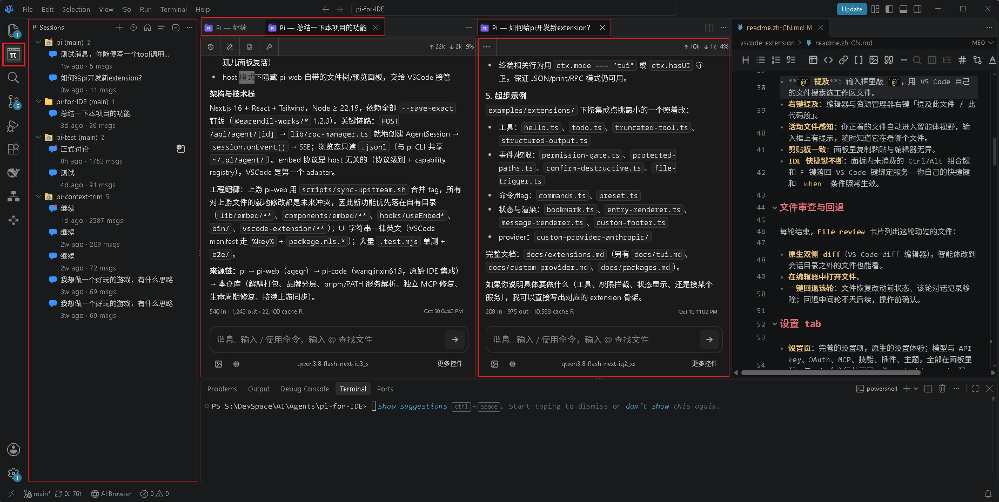
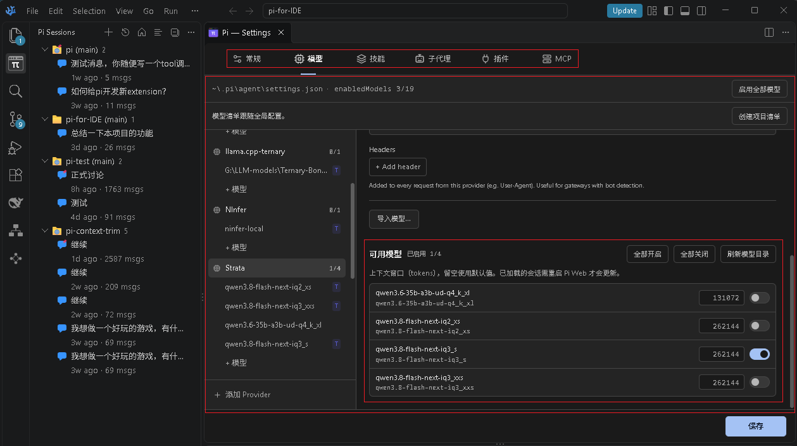
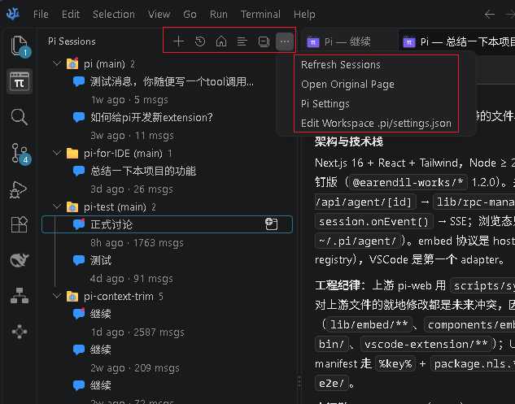
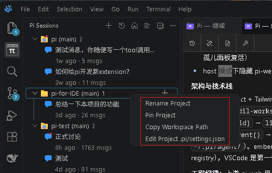
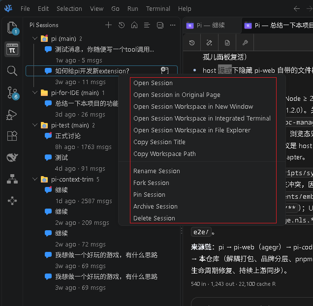
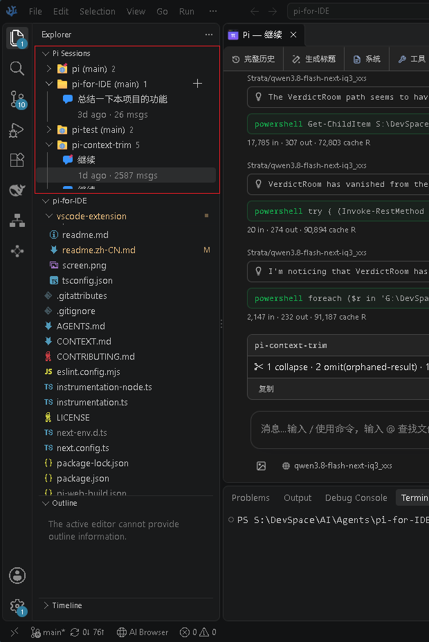
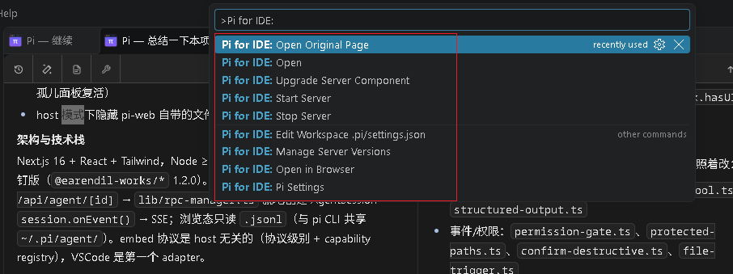

# Pi for IDE / Pi Web+

[中文文档](./docs/README.zh-CN.md)

Embeds the [pi agent](https://github.com/earendil-works/pi)'s web UI into VSCode/VSCodium as a first-class panel, with an IDE-workflow integration layer on top.



This repo ships two independently installable and updateable deliverables:


| Deliverable      | Name                                         | Role                                                                                                                                                                                                                       |
| ---------------- | -------------------------------------------- | -------------------------------------------------------------------------------------------------------------------------------------------------------------------------------------------------------------------------- |
| VSCode extension | **`pi-for-ide`** (`WilliamStone.pi-for-ide`) | **The product**. A lightweight host shell (~190KB): launches/connects to a pi-web server and layers IDE integration inside the webview.                                                                                    |
| npm package      | **`@william_stone/pi-web-for-ide`**          | The substrate. pi-web plus an IDE adaptation layer; IDE features activate when a host embeds it via`?embed=<host>`. CLI command: `pi-web-for-ide` (deliberately distinct from upstream's `pi-web` so the two can coexist). |

The relationship: `@william_stone/pi-web-for-ide` is "pi-web + a host-adaptation layer". Standalone it behaves like stock pi-web (brand slot shows **Pi Web+**); IDE features activate only in embed mode. The extension carries no pi-web payload — the web app installs and upgrades separately.

## IDE integration (the core)

Active only when embedded in VSCode/VSCodium via `?embed=vscode`:

- **Pi Sessions sidebar**: a native activity-bar session tree — by-project/recent/fork-view modes, running/awaiting badges, workspace filter, single- or two-line meta rows, collapse/expand-all, cross-workspace jumps. Session and project context menus carry the actions: open, open in full page, rename, pin, archive, fork, delete, copy title, copy workspace path, reveal in Explorer, open in a new window / integrated terminal / file explorer
- **Sessions as editor tabs**: every session opens as a real editor tab (`perSession`), freely mixed with file tabs and restored in place across window reloads and extension updates — including dead-shell adoption after an extension-host restart; the file-editor title bar gets a `+` button that starts a session in the active file's workspace
- **`@` file mention**: completion queries `vscode.workspace.findFiles` (workspace index, not server filesystem)
- **Right-click mention**: Explorer/editor context menus "Mention in Pi for IDE" for files and selections
- **Active-file context injection**: the file you're viewing is injected into the system prompt as a hidden marker (AI-visible, UI-hidden, never persisted)
- **File review cards + inline diff + one-click revert**: per-turn cards list AI-modified files; reverting restores code and removes the turn — read-only git, no stash/commit
- **Clipboard bridge**: copy/paste inside the sandboxed iframe routes through `vscode.env.clipboard`
- **Shortcut routing**: chords the web app doesn't consume (Ctrl/Alt/Meta combos, F-keys) are forwarded to VS Code's own keybinding service — your keybindings and `when` clauses apply natively
- **Cross-window handoff**: server upgrades/restarts swap every window's panel to the new instance automatically
- **UI trim**: pi-web's file tree/preview panels hide in host mode — VSCode's explorer and editor groups take over
- **Settings tab**: a complete settings surface (models and API keys, OAuth, MCP, skills, plugins, themes) sharing `~/.pi/agent/` with the pi CLI — including a curated enabled-models list per project
- **Drafts survive**: unsent composer text persists across server restarts and window reloads

All pi-web capabilities (session management, streaming chat, model/OAuth/MCP/skills/plugin config, terminal, i18n, themes, PWA) remain available in both modes.

## Screenshots

- Settings UI


Added available model settings

- Session tree view menu
  
- Session tree project menu
  
- Session tree session menu
  
- Session tree embedded
  
- F1 command list
  

## Install & use

Requires Node.js ≥ 22.19.0.

**Step 1 — install the extension**

Published on [Open VSX](https://open-vsx.org/extension/WilliamStone/pi-for-ide) only (for now).

- **VSCodium / Cursor** (Open VSX is their default gallery — no source flag needed):

  ```powershell
  codium --install-extension WilliamStone.pi-for-ide
  ```

  or search `Pi for IDE` in the Extensions view.
- **VS Code**: its gallery can't reach Open VSX and the CLI has no gallery switch — download the `.vsix` from the Open VSX page, then:

  ```powershell
  code --install-extension pi-for-ide-0.6.0.vsix    # or Extensions view → ⋯ menu → Install from VSIX…
  ```

**Step 2 — the server component usually needs no manual install**

On first server start the extension installs a managed runtime automatically (versioned directories under `globalStorage`), and keeps checking for upgrades on its own:

- `Pi for IDE: Upgrade Server Component` moves to the newest; `Pi for IDE: Manage Server Versions` picks which installed version runs.
- `Pi for IDE.installSource` controls the upgrade source (`auto` / `prefer-remote` / `local` / `registry`); `Pi for IDE.localPackage` points at a local `.tgz` or folder for offline/intranet installs.
- Resolution order: `executablePath` → bundled `resources/` → `npm root -g` → the `pi-web-for-ide` PATH shim → managed runtime — a global install wins when present, which is one way to pin a self-maintained server build.

Then open the **Pi Sessions** view in the activity bar or run **Pi for IDE: Open**. On first use, configure a model/API key via the panel's Settings → Models (shares `~/.pi/agent/` with the pi CLI).

**Optional: install the npm package standalone**

Only needed for browser-only mode, or to have the extension attach to a server you launch yourself (pnpm recommended):

```bash
pnpm add -g @william_stone/pi-web-for-ide   # npm i -g works too; local: pnpm i -g ./pi-web-for-ide-0.12.2-3.tgz
```

> Why pnpm: it surfaces the package's postinstall for interactive approval (`pnpm approve-builds`) — needed to link the standalone external packages. npm's script blocking has no equivalent escape hatch. Fallback anyway: `pi-web` self-heals the links on startup (≥0.12.2); see `docs/vscode-extension-deploy.md`.

```bash
pi-web-for-ide            # http://127.0.0.1:3030; see pi-web-for-ide --help for --port/--hostname/--no-open
pi-web status|stop|open|update|update-sdk
```

## Settings (extension)


| Setting                       | Description                                                                                                         |
| ----------------------------- | ------------------------------------------------------------------------------------------------------------------- |
| `Pi for IDE.executablePath`   | Absolute path to a pi-web entry (standalone`server.js` or `bin/pi-web.js`); usually left empty for auto-resolution. |
| `Pi for IDE.workspaceRoot`    | Project dir for sessions (`cwd`); defaults to the workspace folder.                                                 |
| `Pi for IDE.openBeside`       | Open the panel in the adjacent column (default true).                                                               |
| `Pi for IDE.port`             | Preferred starting port (default 3030; auto-increments when busy).                                                  |
| `Pi for IDE.package`          | Package name for managed-runtime and global lookup (default`@william_stone/pi-web-for-ide`).                        |
| `Pi for IDE.autoStart`        | Start the server when the editor loads (default off).                                                               |
| `Pi for IDE.autoStop`         | Let the spawned server exit after everyone disconnects (default on).                                                |
| `Pi for IDE.autoStopAfterSec` | Silence before self-stop, min 90s (default`90`).                                                                    |
| `Pi for IDE.checkForUpdates`  | Notify when a newer server package exists (default on).                                                             |
| `Pi for IDE.localPackage`     | Path to a local server tarball, or a folder of`.tgz` builds — the newest wins by `(version, builtAt)`.             |
| `Pi for IDE.installSource`    | Upgrade source:`auto` (same version → local), `prefer-remote` (same version → registry), `local`, `registry`.     |

Can't connect, blank panel, save errors: see [docs/vscode-extension-deploy.md](./docs/vscode-extension-deploy.md).

## For developers

Server-entry resolution order (extension side): `Pi for IDE.executablePath` → bundled `resources/` (transitional) → `npm root -g` → `pi-web-for-ide` PATH shim (only our package's own command name is accepted — an upstream `pi-web` shim is never launched) → versioned managed runtime under `globalStorage` (auto-installed; see [docs/agents/managed-runtime.md](./docs/agents/managed-runtime.md)). After spawn it probes `GET /api/embed` and warns when the connected server lacks the IDE patch.

Architecture:

```
pi-for-ide extension (VSCode)
  ├── piIdeServer        resolve entry → spawn pi-web → probe /api/embed
  ├── webviewProvider    <iframe src="…/?embed=vscode"> + readiness gate
  └── bridge             page ↔ VSCode API: openFile / completeAt /
                         clipboard / snapshots / revert / activeEditor
@william_stone/pi-web-for-ide (external package)
  └── embed host abstraction (?embed=<host>) — host-agnostic protocol;
      VSCode is the first adapter, JetBrains-class hosts can follow
```

Build & sync:

```bash
npm install                 # deps
npm run build               # next build (browser app)
node scripts/prepare-standalone.js   # standalone assembly used by npm pack
npm pack                    # → @william_stone/pi-web-for-ide-<ver>.tgz
cd vscode-extension && npm run compile && npm run package   # → pi-for-ide-<ver>.vsix
bash scripts/sync-upstream.sh vX.Y.Z   # merge an upstream pi-web tag
```

Do not run `next build` or `npm run build` during normal development. It writes to `.next/` and can interfere with the development server; leave builds for release work.

`PI_WEB_STANDALONE=1` flips the build into Next standalone output; `scripts/` holds the upstream-sync and patch-export toolchain (`sync-upstream.sh`, `export-patches.sh`, `apply-to.sh`).

Contributor guides: [Internationalization](./docs/i18n.md) and [Release process](./docs/publishing.md).

## Repository Layout

```text
app/               Next.js UI and API routes
components/        React UI components
hooks/             Client state and interaction hooks
lib/               Session, agent, model, file, Git, and security logic
public/            Static assets and PWA files
bin/               npm CLI entrypoint and launch option parsing
vscode-extension/  The pi-for-ide VSCode/VSCodium extension shell
docs/              Focused user and contributor guides
demo/              Static browser demo published to GitHub Pages (see demo/README.md)
```

See [AGENTS.md](./AGENTS.md) for the architecture notes and detailed file map.

## Upstream & credits

- **[pi](https://github.com/earendil-works/pi)** (earendil-works): the underlying coding agent.
- **[pi-web](https://github.com/agegr/pi-web)** (agegr): the Next.js web UI for pi — the interface the panel hosts.
- **[pi-code](https://github.com/wangjinxin613/pi-code)** (wangjinxin613): the original IDE integration — the extension, embed bridge, file review/revert, and active-file injection all originate there; this extension is rebuilt on that work.
- **[Pi-for-IDE](https://github.com/WilliamStone/Pi-for-IDE)** (this repo): what this project adds on top of pi-code:
  - Native **Pi Sessions** tree (activity bar): by-project / recent modes, single- and two-line meta layouts, a collapse/expand-all two-state button, workspace filter, awaiting badges, cross-workspace jumps.
  - Split tab system: sessions, composer, and settings each get their own tabs (`perSession`); lazy placeholder restore across window reloads and extension updates; tab context actions and full-page reload.
  - Multi-window / multi-tab concurrency groundwork: extension-side SSE event proxy (works around the webview connection-pool ceiling), shared server instance and instance coordination, server auto start/stop, embed lifecycle protocol evolution.
  - Server management: version checks and upgrades against both a local folder and the npm registry, local-package install source.
  - Project-level config: `.pi/settings.json` editing, per-project enabled-model lists, composer drafts that survive restarts.
  - Independent distribution: the `@william_stone/pi-web-for-ide` npm package and this extension, no longer released as one bundle.

## License

[MIT](./LICENSE)
