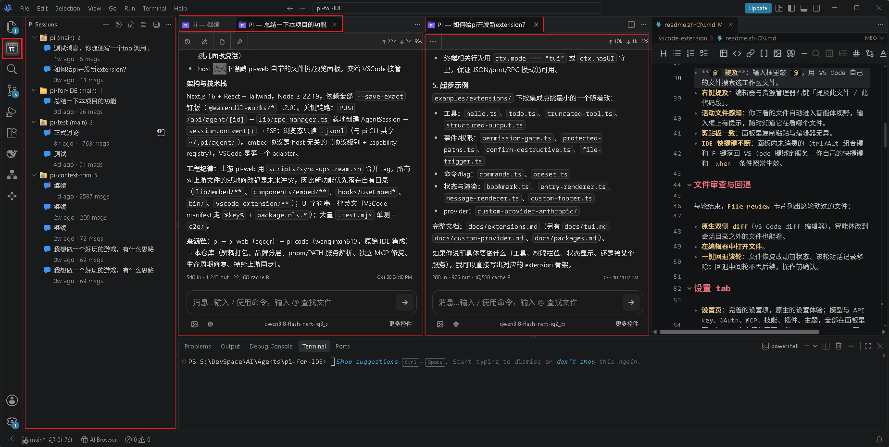
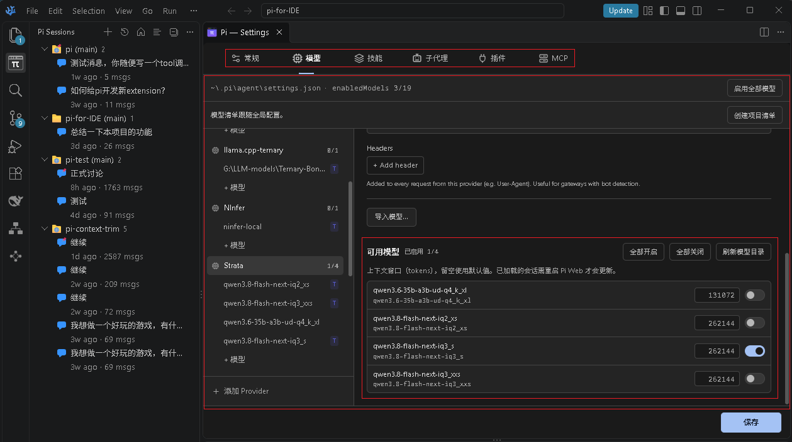
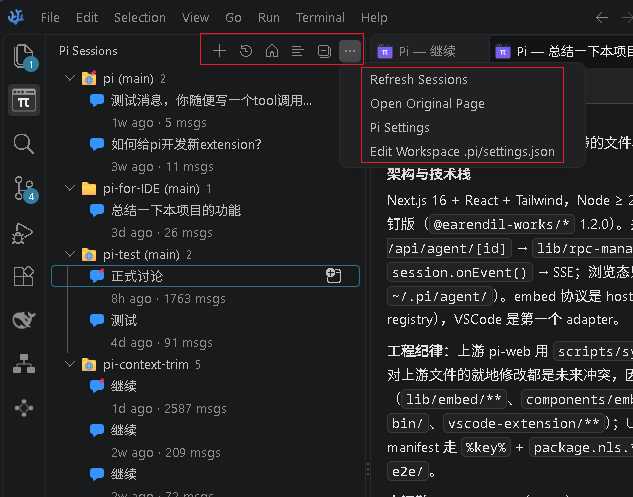
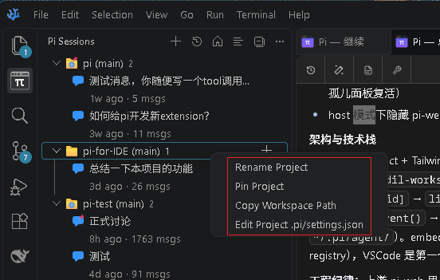
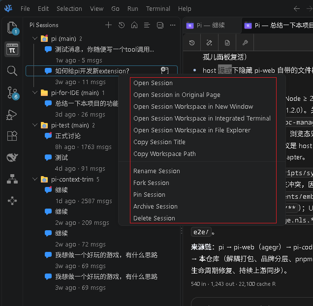
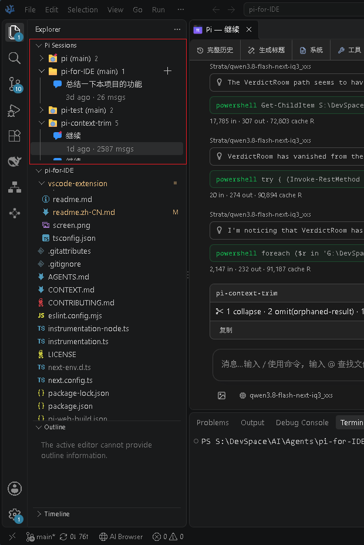
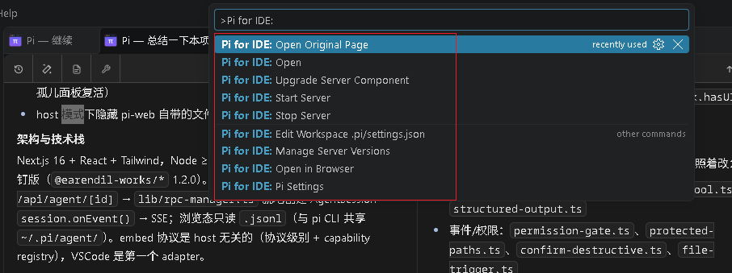

# Pi for IDE / Pi Web+

[English](../README.md)

把 [pi 智能体](https://github.com/earendil-works/pi) 的 Web 界面作为一等面板嵌入 VSCode/VSCodium，并叠加一层面向 IDE 工作流的集成能力。



本仓库产出两个可独立安装、独立更新的产物：

| 产物 | 名称 | 角色 |
|---|---|---|
| VSCode 扩展 | **`pi-for-ide`**（`WilliamStone.pi-for-ide`） | **主体**。轻量宿主壳（~190KB）：拉起/连接 pi-web 服务器，在 webview 内叠加 IDE 集成。 |
| npm 包 | **`@william_stone/pi-web-for-ide`** | 底座。pi-web + IDE 适配层；被宿主以 `?embed=<host>` 嵌入时激活 IDE 能力，否则仍提供原版能力。CLI 命令：`pi-web-for-ide`（刻意区别于上游 `pi-web`，两者可共存）。 |

两者的关系：`@william_stone/pi-web-for-ide` 就是"pi-web + 一层宿主适配"，独立运行时与原版 pi-web 无异（品牌位显示 **Pi Web+**）；IDE 特性只在嵌入模式下激活。扩展本身不再携带 pi-web——pi-web 单独安装、单独升级，扩展只负责拉起与桥接。

## IDE 集成（本项目的主体功能）

以下能力只在 VSCode/VSCodium 内以 `?embed=vscode` 嵌入时激活：

- **Pi Sessions 侧栏**：活动栏上的原生会话树——项目分组/最近/fork 树三种模式、运行中/待输入徽标、工作区过滤、单行/双行元信息布局、折叠/展开双态、跨工作区跳转。会话与项目右键菜单承载全部动作：打开、整页打开、重命名、钉住、归档、fork、删除、复制标题、复制工作区路径、资源管理器定位、新窗口/集成终端/文件管理器打开工作区
- **会话开在编辑器标签页**：每个会话一个真实标签（`perSession`），与文件标签自由混排，窗口重载与扩展升级后原位恢复——扩展宿主重启后的死壳也能收养复活；文件编辑器标题栏提供 **+** 按钮，在活动文件所属工作区一键新建会话
- **`@` 文件提及**：补全走 `vscode.workspace.findFiles`，按工作区索引而不是服务器文件系统
- **右键提及**：资源管理器/编辑器右键「Pi for IDE 提及」文件与选中代码段
- **活动文件上下文注入**：正在查看的文件以隐藏 marker 注入 system prompt（AI 可见、UI 不显示、不落盘）
- **文件审查卡片 + inline diff + 一键回退**：每轮列出 AI 改动文件；回退恢复代码并删除该轮记录——只读 git，不产生 stash/commit
- **剪贴板桥接**：沙箱 iframe 里的复制/粘贴改走 `vscode.env.clipboard`
- **快捷键路由**：面板内未消费的 Ctrl/Alt/Meta 组合键和 F 键落回 VS Code 键绑定服务——自定义快捷键与 `when` 条件照常生效
- **跨窗口接力**：服务端升级/重启自动把所有窗口的面板切到新实例
- **界面裁剪**：内置文件树/预览面板在宿主模式下隐藏，交还 VSCode 资源管理器与编辑器组
- **设置 tab**：完整的设置界面（模型与 API key、OAuth、MCP、技能、插件、主题），与 pi CLI 共享 `~/.pi/agent/`——含按项目的精选模型清单
- **草稿不丢**：输入框中未发送的文字，服务重启、窗口重载后仍在

pi-web 本体的能力（会话管理、流式对话、模型/OAuth/MCP/技能/插件配置、终端、i18n、主题、PWA）全部保留，独立与嵌入模式都可用。

## 界面截图

- 设置界面


增加了可用模型设置

- 会话树视图菜单


- 会话树项目菜单


- 会话树会话菜单


- 会话树嵌入其他视图


- F1命令清单


## 安装与使用

要求 Node.js ≥ 22.19.0。

**第一步：安装扩展**

目前只发布到 [Open VSX](https://open-vsx.org/extension/WilliamStone/pi-for-ide)。

- **VSCodium / Cursor**（默认商店即 Open VSX，无需指定源）：

  ```powershell
  codium --install-extension WilliamStone.pi-for-ide
  ```

  或扩展面板搜索 `Pi for IDE` 安装。

- **VS Code**：扩展面板装不了 Open VSX，CLI 也没有选商店的参数——从 Open VSX 页面下载 `.vsix` 后安装：

  ```powershell
  code --install-extension pi-for-ide-0.6.0.vsix    # 或扩展面板右上 ⋯ 菜单 → Install from VSIX…
  ```

**第二步：服务端组件——通常无需手动安装**

扩展首次拉起服务时会自动从 npm 安装托管运行时（`globalStorage` 下按版本分目录共存），之后的检查升级也自动：

- `Pi for IDE: Upgrade Server Component` 升到最新；`Pi for IDE: Manage Server Versions` 选择运行哪个已装版本。
- `Pi for IDE.installSource` 控制升级来源（`auto`/`prefer-remote`/`local`/`registry`）；`Pi for IDE.localPackage` 指向本地 `.tgz` 或目录即可离线/内网安装。
- 解析顺序：`executablePath` → 内置 `resources/` → `npm root -g` → `pi-web-for-ide` PATH shim → 托管运行时——全局安装若存在会优先命中，可用它锁死自维护的服务端版本。

然后打开活动栏的 **Pi Sessions** 视图，或命令面板执行 **Pi for IDE: Open**。首次使用在面板内 Settings → Models 配模型/API Key（与 pi CLI 共享 `~/.pi/agent/` 配置）。

**可选：独立安装 npm 包**

想要脱离 IDE 的浏览器模式、或让扩展接入你自己拉起的服务时，才需要全局安装（推荐 pnpm）：

```bash
pnpm add -g @william_stone/pi-web-for-ide   # 也可用 npm i -g；本地包：pnpm i -g ./pi-web-for-ide-0.12.2-3.tgz
```

> 推荐 pnpm 的原因：它装完会列出待批准的构建脚本并可交互勾选确认（`pnpm approve-builds`）——包的 postinstall 要把 standalone 外部包接成 junction；npm 的脚本拦截则没有对应入口。被拦了也有兜底：`pi-web` 启动时会自检补链（≥0.12.2），见 `docs/vscode-extension-deploy.md` 排障节。

```bash
pi-web-for-ide            # http://127.0.0.1:3030；--port/--hostname/--no-open 等参数见 pi-web-for-ide --help
pi-web status|stop|open|update|update-sdk
```

## 设置项（扩展）

| 设置 | 说明 |
|---|---|
| `Pi for IDE.executablePath` | pi-web 入口绝对路径（standalone `server.js` 或 `bin/pi-web.js`）；一般留空自动解析。 |
| `Pi for IDE.workspaceRoot` | 传给会话的项目目录（`cwd`）；留空用当前工作区文件夹。 |
| `Pi for IDE.openBeside` | 面板打开在右侧相邻分栏（默认 true）。 |
| `Pi for IDE.port` | 起始端口（默认 3030，被占用自动 +1）。 |
| `Pi for IDE.package` | 托管/全局查询用的包名（默认 `@william_stone/pi-web-for-ide`）。 |

连不上服务器、面板空白、保存报错等排障指引：[vscode-extension-deploy.md](./vscode-extension-deploy.md)；用户侧的逐级恢复梯子（面板空白/加载卡住/升级不到）见[扩展 readme 的「故障恢复」](../vscode-extension/readme.zh-CN.md#故障恢复)。

## 面向开发者

服务器入口解析顺序（扩展侧）：`Pi for IDE.executablePath` → 内置 `resources/`（过渡兼容）→ `npm root -g` → `pi-web-for-ide` PATH shim（只认本包专属命令名，上游 `pi-web` shim 不会被拉起）→ `globalStorage` 下版本化托管运行时（自动安装）。启动后探测 `GET /api/embed`，所连服务器不含 IDE 补丁时弹警告。

架构：

```
pi-for-ide 扩展（VSCode）
  ├── piIdeServer        解析入口 → spawn pi-web → 探测 /api/embed
  ├── webviewProvider    <iframe src="…/?embed=vscode"> + 就绪门
  └── bridge             页面 ↔ VSCode API：openFile / completeAt /
                         clipboard / 快照 / 回退 / activeEditor
@william_stone/pi-web-for-ide（外部包）
  └── embed 宿主抽象（?embed=<host>）——宿主无关协议，VSCode 是首个
      适配器，后续可接 JetBrains 等其他宿主
```

构建与同步：

```bash
npm install                 # 依赖
npm run build               # next build（浏览器应用）
node scripts/prepare-standalone.js   # npm pack 使用的 standalone 组装
npm pack                    # → @william_stone/pi-web-for-ide-<ver>.tgz
cd vscode-extension && npm run compile && npm run package   # → pi-for-ide-<ver>.vsix
bash scripts/sync-upstream.sh vX.Y.Z   # 合并上游 pi-web 某个 tag
```

日常开发时不要运行 `next build` 或 `npm run build`。它们会写入 `.next/`，可能干扰开发服务器；仅在发布流程中执行构建。

`PI_WEB_STANDALONE=1` 开启 Next standalone 输出；`scripts/` 下是上游同步与补丁导出工具链（`sync-upstream.sh`、`export-patches.sh`、`apply-to.sh`）。

开始做新功能之前，请先阅读[参与贡献](./CONTRIBUTING.zh-CN.md)，了解哪些改动在范围内以及提交 PR 前的检查项。

贡献者文档：[国际化](./i18n.md)和[发布流程](./publishing.md)。

## 仓库结构

```text
app/               Next.js 界面和 API 路由
components/        React 界面组件
hooks/             客户端状态和交互 hooks
lib/               会话、智能体、模型、文件、Git 和安全逻辑
public/            静态资源和 PWA 文件
bin/               npm CLI 入口及启动参数解析
vscode-extension/  pi-for-ide VSCode/VSCodium 扩展壳
docs/              面向用户和贡献者的专题文档
demo/              发布到 GitHub Pages 的静态演示站（见 demo/README.md）
```

架构说明和详细文件地图见 [AGENTS.md](../AGENTS.md)。

## 上游与各层贡献

- **[pi](https://github.com/earendil-works/pi)**（earendil-works）：底层的编程智能体。
- **[pi-web](https://github.com/agegr/pi-web)**（agegr）：pi 的 Next.js Web 界面——本扩展面板里的界面即来自它。
- **[pi-code](https://github.com/wangjinxin613/pi-code)**（wangjinxin613）：最初的 IDE 集成——扩展、嵌入桥、文件审查/回退、活动文件注入皆源于此，本扩展在其基础上重构而来。
- **[Pi-for-IDE](https://github.com/WilliamStone/Pi-for-IDE)** (This Repo)：在 pi-code 基础上，本项目的演进：

  - 原生 **Pi Sessions** 树（活动栏）：项目分组/最近双模式、单双行元信息布局、折叠/展开双态、工作区过滤、等待输入徽标、跨工作区跳转。
  - 分体标签体系：会话/composer/设置各自标签化（`perSession`），窗口重载与扩展升级后懒占位恢复，标签右键动作与整页重载。
  - 多窗口/多标签并发基建：扩展侧 SSE 事件代理（绕开 webview 连接池上限）、共享服务实例与实例协调、服务自动启停、嵌入生命周期协议演进。
  - 服务端管理：本地目录与 npm 仓库双源版本检查与升级、本地包安装来源。
  - 项目级配置：`.pi/settings.json` 编辑入口、按项目启用模型清单、输入框草稿跨重启保留。
  - 独立分发：`@william_stone/pi-web-for-ide` npm 包 + 本扩展，不再打包统一发布。

## 许可证

[MIT](../LICENSE)
