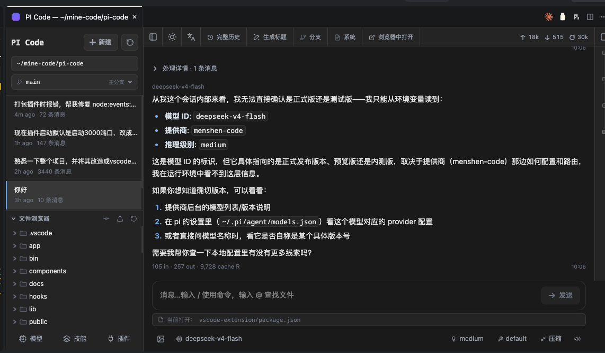

# PI Code — VSCode 扩展



**PI Code** 是在 [pi-web](https://github.com/agegr/pi-web)（pi 编程智能体的 Next.js Web UI）基础上构建的 VSCode 扩展。它把 pi-web 的完整 Web 界面封装为一个自包含的 webview 面板，让你不必离开 VSCode 就能与 pi 编程智能体对话、浏览会话历史、配置模型与技能，并叠加了一层针对 VSCode 工作流的深度集成。

pi-web 本身仍是独立可运行的 Web 应用，本扩展只是把它"搬进" VSCode 并补充原生集成能力。

## 核心功能

### 1. 自包含的 Web 面板
- pi-web 的 standalone 产物随扩展一同打包，**无需全局安装** `pi-web`，扩展自动拉起本地服务器并以 iframe 渲染。
- 服务器默认监听 **3030** 端口（被占用时自动 +1 找空闲端口），面板顶部有「**在浏览器中打开**」按钮，一键在系统默认浏览器中打开 PI Code；面板标题栏和命令面板（`PI Code: 在浏览器中打开 PI Code`）也提供同一入口。
- 会话浏览、Markdown 渲染、工具调用展示、分支导航、SSE 流式输出、i18n、主题——pi-web 的能力全部保留。

### 2. VSCode 工作区集成
- **文件浏览交还 VSCode**：pi-web 原生的文件树 / 预览面板 / Tab 栏 / worktree 切换器在 VSCode 模式下隐藏，由 VSCode 资源管理器与编辑器组承接。
- **`@` 文件提及**：输入框内的 `@` 补全通过 `vscode.workspace.findFiles` 落到 VSCode API，结果上限 50 条，只含行号不含代码内容。
- **右键提及**：编辑器 / 资源管理器右键菜单提供「在 PI Code 中提及此文件 / 此代码」。
- **剪贴板桥接**：跨源 iframe 中 `navigator.clipboard` 受权限策略限制，复制 / 粘贴改走 `vscode.env.clipboard`，并对非输入框文字复制做了全局拦截。

### 3. 深色主题 + 中文界面
- 默认深色配色，与 VSCode 暗色主题视觉一致；界面文案默认中文（`zh-CN`）。

### 4. 文件审查 + Diff + 一键回退
每轮对话结束后，扩展会在该轮消息附近展示**文件审查卡片**，列出 AI 改动过的文件：
- **inline Diff**：纯前端渲染 unified diff（edit 工具用 `toolResult.details.diff`，write 工具构造伪 unified diff），无需依赖 git。
- **一键回退**：在用户消息左侧提供「回退此轮」入口（hover 显示）。
  - **edit 回退**：纯文件系统反向 apply（反序遍历 `edits`，把 `newText` 写回为 `oldText`），零 git、零快照。
  - **write 回退**：基于快照恢复（只读 git 取旧内容，绝不删除文件）。
  - 回退 = **恢复代码 + 删除该轮会话记录**（parentId 自动重连，中间轮回退不会丢后续轮次），完成后自动刷新会话，对应消息与审查卡片一并消失。
- **不污染用户 git**：全程只读 git，绝不创建 stash / commit / dangling object；任何 git 写入操作前都会向用户确认。

### 5. 当前文件上下文注入
- 扩展监听 VSCode 活动编辑器，把**用户正在查看的文件**以隐藏形式注入 system prompt（marker 包裹，LLM 可见、UI 不显示、不落盘到 session 文件），AI 会优先考虑直接修改这些正在打开的文件。
- **缓存最后一次有效活动编辑器**：用户切到 PI Code 面板时编辑器失焦，但文件标签仍展示——缓存生效，注入与提示不丢；文件真正关闭时才清除。
- 输入框下方显示当前文件提示「📄 当前打开：xxx」，让用户清楚 AI 知道哪个文件。

### 6. 模型 / 技能 / 插件配置
- 直接复用 pi-web 的配置面板：OAuth 登录与 API Key 管理、models.json 编辑、技能搜索与安装、包插件启用 / 禁用，全部在 webview 内完成。

## 架构

```
扩展宿 (extension.ts)
  ├── PiWebServer          以子进程启动打包进扩展的 pi-web standalone 服务器
  ├── PiWebWebviewPanel    注册 webview 面板，渲染 <iframe> 指向本地服务器
  └── Bridge               处理页面 ↔ VSCode 的请求：
                            openFile / completeAt / readFile / notify
                            clipboardRead / clipboardWrite
                            captureSnapshot / getBeforeContent / showDiff
                            revertFiles / revertEdit / getActiveEditor
```

消息路径（postMessage 桥接）：

```
pi-web 页面 (iframe)
  ── window.parent.postMessage({ source: "pi-web", id, request }) ──▶ webview HTML
  ── vscode.postMessage(...) ──▶ 扩展宿
  ◀── webview.postMessage({ source: "vscode", id, payload }) ── 扩展宿
  ◀── iframe.contentWindow.postMessage(...) ── webview HTML
  ◀── window 'message' 监听 ── pi-web 页面 (lib/vscode-bridge.ts)
```

## 开发与构建

```bash
cd vscode-extension
npm install
npm run compile      # tsc -p .   → out/
npm run watch       # 监听模式
```

打包 `.vsix`（会先把 pi-web standalone 产物复制到 `resources/pi-web/`）：

```bash
npm run package
```

## 运行（调试）

1. 先在仓库根目录 `npm run build` 产出 pi-web 的 `.next/` 产物。
2. 在 `vscode-extension/` 目录 F5 启动调试，命令面板运行 **PI Code: 打开 PI Code**，或点击编辑器标题栏的 PI Code 图标。
3. 扩展按需启动打包进扩展的 pi-web 服务器，无需全局安装。

## 设置项

| 设置 | 说明 |
|---|---|
| `piWeb.executablePath` | pi-web 可执行文件（`bin/pi-web.js`）的绝对路径；留空则自动从 PATH 或工作区查找。打包进扩展的 standalone 产物优先使用。 |
| `piWeb.workspaceRoot` | 传给 pi-web 会话的项目目录（`cwd`）；留空则用当前工作区文件夹。 |
| `piWeb.openBeside` | 是否将 PI Code 面板打开在右侧相邻分栏（默认 true）。 |
| `piWeb.port` | PI Code 服务器起始端口（默认 3030）；被占用时自动 +1 查找空闲端口。 |

## 限制

- pi-web 页面在 webview iframe 中以 sandbox 运行，`window.confirm()` / `alert()` / `prompt()` 被禁用，所有确认交互改用 UI 内弹层（如回退确认、toast 通知）。
- `?vscode=1` 让 pi-web 隐藏文件浏览器相关 UI，但**不破坏**其在普通浏览器里的独立运行能力。
- `@` 文件补全回退到 VSCode 的 `findFiles`，结果上限 50 条。
