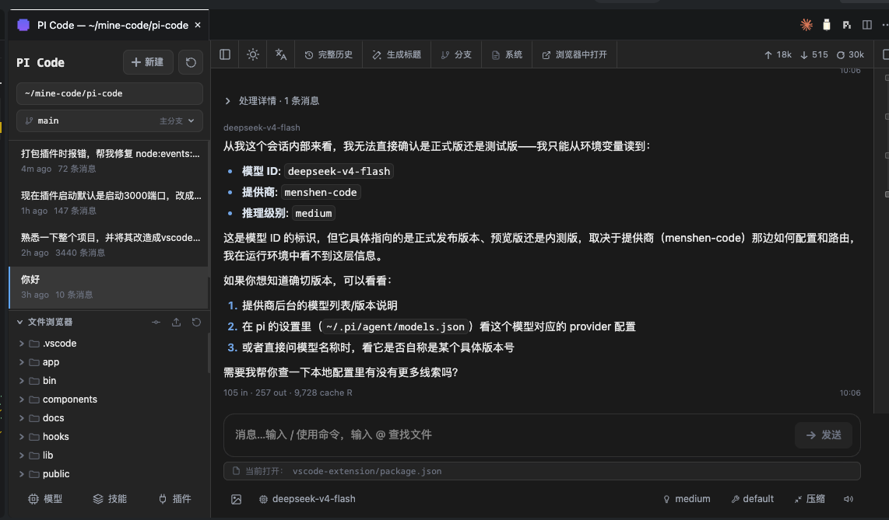

# Pi for IDE — VS Code extension

[**Pi for IDE**](https://github.com/WilliamStone/Pi-for-IDE) puts the full [pi-web](https://github.com/agegr/pi-web) interface inside a VS Code panel — chat with the pi coding agent, browse session history, configure models and skills — plus a set of editor-native integrations: real diffs, `@` file mentions, and one-click revert.

The web app stays a standalone product: the same server runs in your browser, and the extension and web app upgrade independently.

## What you get

### The whole pi web UI, in your IDE

Click the **Pi for IDE button** in the bottom-right of the IDE status bar (or run `Pi for IDE: Open`) — the panel opens beside your code: session browsing, streaming output, tool-call views, branch navigation, themes, multi-language UI.

- **Works out of the box**: on first use the extension can download and manage the server component itself — just open the panel. Prefer the CLI? `pnpm add -g @william_stone/pi-web-for-ide` puts `pi-web-for-ide` on PATH and the extension picks it up automatically.
- **One server, shared**: when a compatible server is already running (another window, or one you started), the panel connects to it instead of starting a duplicate — one shared view of sessions and data. When it connects to an existing instance, a notice tells you which one.
- **Clear diagnostics**: if the connected server can't provide IDE integration (wrong package, outdated version, incomplete install), you get a specific warning with the exact fix command — never a silent blank panel.
- **Always reachable**: the panel's **Open in Browser** button opens the same server in your system browser.

### Feels native to your workspace

- **`@` mentions**: type `@` in the composer to pick workspace files — powered by VS Code's own file search.
- **Right-click mentions**: *Mention This File* / *Mention This Code* on the editor and Explorer context menus.
- **Clipboard just works**: copy/paste inside the panel behaves like everywhere else in the editor.
- **Active-file awareness**: the file you're viewing is quietly placed in the agent's context — the composer shows a hint so you always know which file it's looking at.

### Review and undo agent changes

After each turn, a **File review** card lists the files the agent touched:

- **Open diff in editor** — a native two-sided VS Code diff of that turn's changes.
- **Open file in editor** — jump straight to the file.
- **Revert this turn** — hover a user message and hit *Revert*: every file the turn touched returns to its pre-turn state, and the turn's conversation entries are removed. Reverting a middle turn never loses later turns. Always confirmed first.

### Looks after itself

- **Leaves no trace**: a server started by the extension exits on its own shortly after the last window or page disconnects — nothing left running overnight.
- **You're in control**: `Pi for IDE: Start Server` / `Stop Server` any time; `Pi for IDE.autoStart` can also bring it up with the editor.
- **Upgrades don't wedge**: upgrading the package while a server is running tells you to stop first instead of leaving a broken half-install.

## Commands

| Command | What it does |
|---|---|
| `Pi for IDE: Open` | Open the Pi for IDE panel |
| `Pi for IDE: Show Panel` | Reveal an already-created panel |
| `Pi for IDE: Start Server` | Start the local server |
| `Pi for IDE: Stop Server` | Stop the server this window manages |
| `Pi for IDE: Open in Browser` | Open the same UI in your system browser |
| `Pi for IDE: Mention This File` | Mention the active file in the composer |
| `Pi for IDE: Mention This Code` | Mention the current selection |
| `Pi for IDE: Upgrade Server Component` | Update the server component |
| `Pi for IDE: Manage Server Versions` | Choose which installed version runs |

## Settings

| Setting | What it controls |
|---|---|
| `Pi for IDE.autoStart` | Start the server when the editor loads (default off). |
| `Pi for IDE.autoStop` | Let the spawned server exit after everyone disconnects (default on). |
| `Pi for IDE.autoStopAfterSec` | Silence before self-stop, min 90s (default `90`). |
| `Pi for IDE.port` | Preferred port (default `3030`; auto-bumps when taken). |
| `Pi for IDE.workspaceRoot` | Which folder the agent works in. Empty → current workspace. |
| `Pi for IDE.openBeside` | Open the panel in the adjacent column (default on); off → the active column. |
| `Pi for IDE.executablePath` | Point at a specific server build. Empty → automatic. |
| `Pi for IDE.package` | Which package provides the server (default `@william_stone/pi-web-for-ide`). |
| `Pi for IDE.checkForUpdates` | Notify when a newer server package exists (default on). |

## Notes

- Runs standalone in a browser just like upstream pi-web — one package, two uses.
- Want a dedicated server that's never shared? Set `Pi for IDE.port` outside 3030–3039.
- Revert restores each touched file to its pre-turn state — manual edits you made to the same file *after* the turn are overwritten (files the turn never touched are unaffected). Confirm before reverting.
