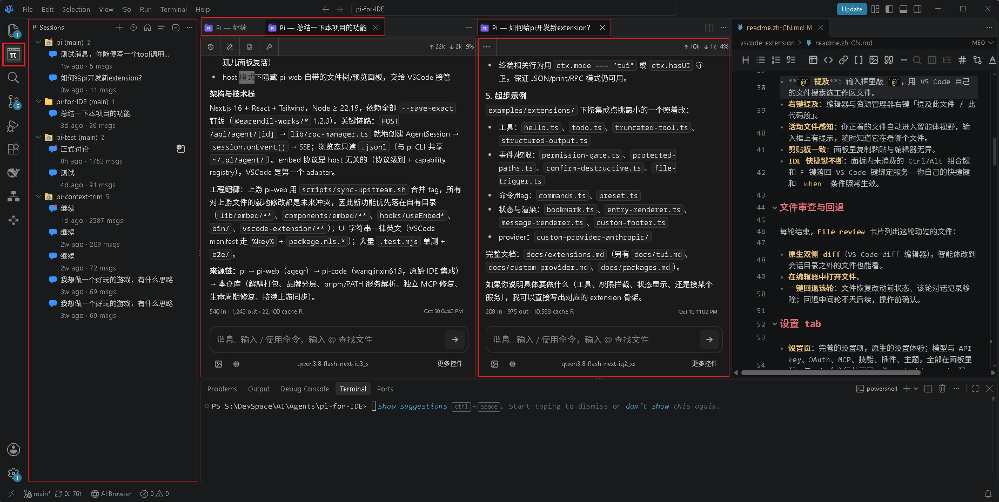
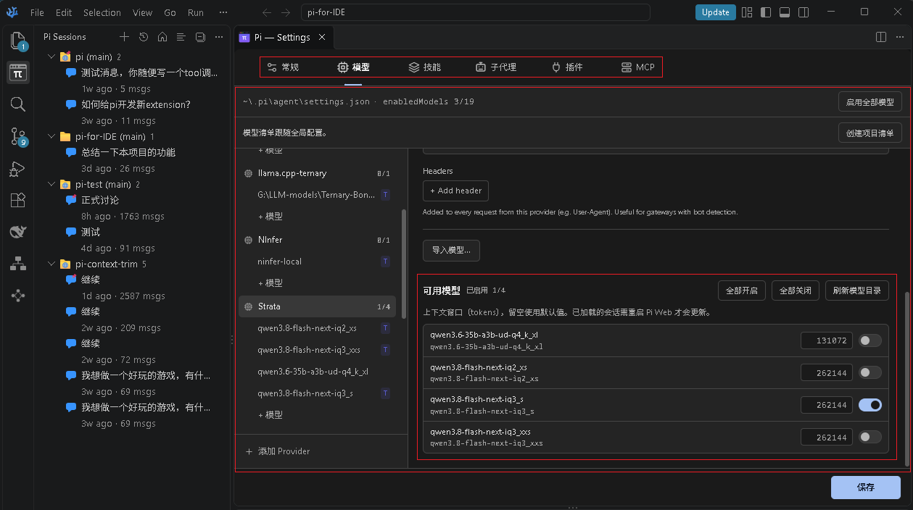
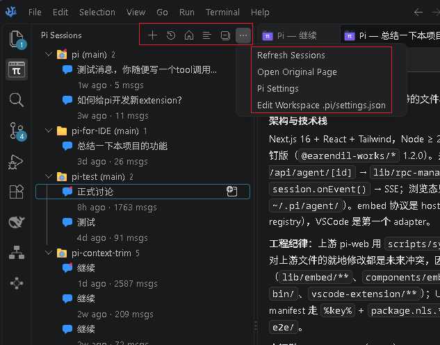
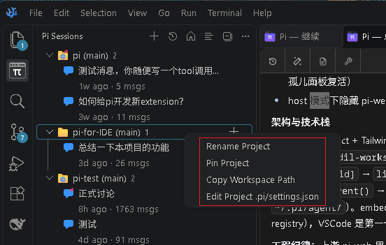
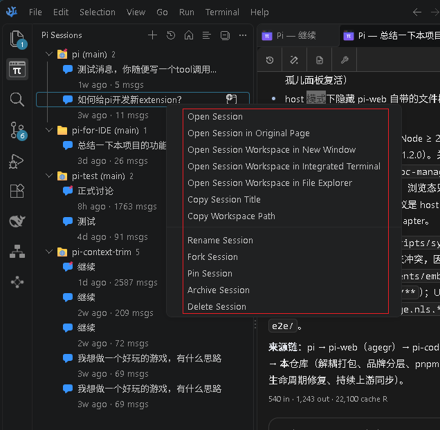
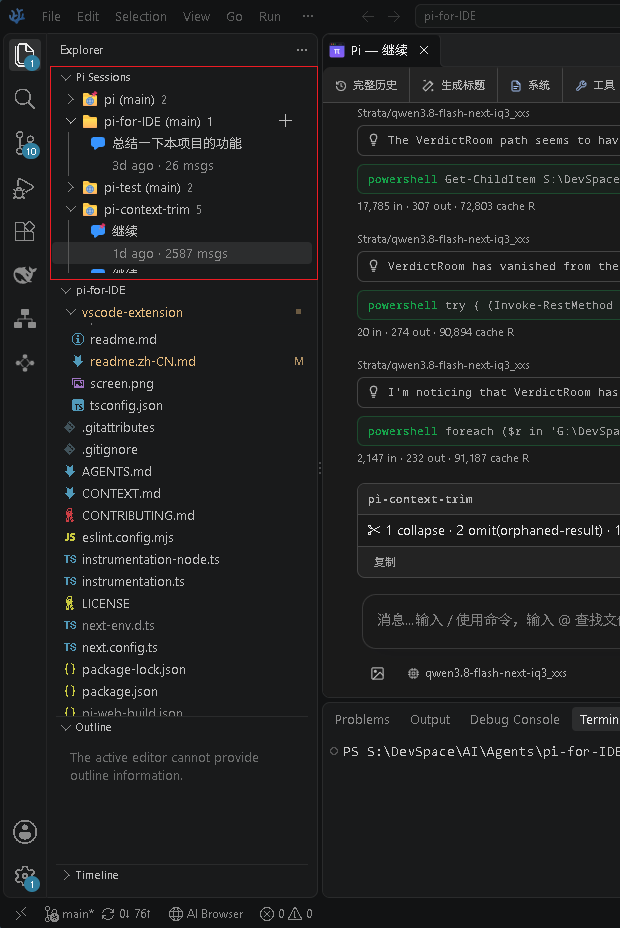
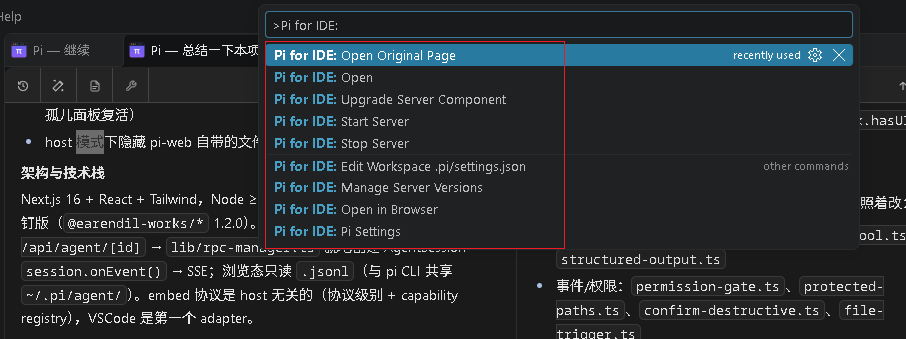

# Pi for IDE — VS Code 扩展

**[Pi for IDE](https://github.com/WilliamStone/Pi-for-IDE)** 把 Pi 智能体做成编辑器的一部分：会话列表是活动栏里的原生树视图，对话与设置在标签页中打开，文件审查走原生 diff——它看起来、用起来都像 IDE 自带的功能，而不是一个嵌进来的网页应用。

## 主要功能

### Pi Sessions 侧栏（活动栏）

活动栏上的 **Pi Sessions**——一棵原生会话树，所有会话的入口：

- **自由布局**：与其他活动栏视图一样，可以自由拖拽到任意位置，或与其他视图合并。
- **工作区过滤**：可切换只看当前工作区的会话/全部会话；其它工作区的会话和项目可在新的对应工作区窗口中打开。
- **按项目分组**（或切换为平铺「最近」模式），正在运行 / 等待输入的会话带状态图标；项目和会话都可以钉到顶部。
- **会话元信息**：显示会话最后活动时间、消息数量，便于在众多会话中快速定位；行尾/双行布局切换。
- **全部折叠 / 全部展开**：在项目和会话众多时增加便利。
- **会话操作**：打开、整页打开、重命名、钉住、归档、fork、删除、复制标题、复制工作区路径；目录动作：在资源管理器定位、新窗口打开工作区、集成终端打开。
- **项目操作**：新建会话、重命名、钉住、复制路径、编辑项目 `.pi/settings.json`；
- **跨工作区跳转**：别的工作区的会话，一键把它送进它自己的窗口。
- **等待输入提醒**：等你的会话在树上带徽标、在状态栏带计数（点击循环到下一个），并可开通知。
- **设置入口**：打开全局设置页面；编辑项目级 `.pi/settings.json`。
- **草稿不丢**：输入框中未发送的文字，服务重启、窗口重载后仍在。

### 会话标签页（编辑器区）

会话开在**编辑器标签页**里，和代码文件同级：

- **每会话一个标签**（`perSession`）或共用一个（`shared`）——`Pi for IDE.sessionTabs`。
- **多会话并行**：每会话一标签，任意多会话同时在编辑器里铺开，任意与其他tab混合排列。
- **完整的对话体验**：流式输出、工具调用详情、分支导航、完整历史 / 系统 / 工具 / token 统计多视角切换、主题与多语言界面——排版与交互贴合 IDE。
- **标签右键菜单**：在会话树中定位该会话、复制其工作区路径、重载页面。
- **重载与更新后原样存活**：窗口重载、扩展升级后，会话标签保留标题原位恢复。
- 文件编辑器标题栏上的 **+** 按钮：看代码时一键在活动文件所属工作区新建会话。

#### 编辑器联动

- **`@` 提及**：输入框里敲 `@`，用 VS Code 自己的文件搜索选工作区文件。
- **右键提及**：编辑器与资源管理器右键「提及此文件 / 此代码段」。
- **活动文件感知**：你正看的文件自动进入智能体视野，输入框上有提示，随时知道它在看哪个文件。
- **剪贴板一致**：面板里复制粘贴与编辑器无异。
- **IDE 快捷键不断**：面板内未消费的 Ctrl/Alt 组合键和 F 键落回 VS Code 键绑定服务——你自己的快捷键和 `when` 条件照常生效。

#### 文件审查与回退

每轮结束，**File review** 卡片列出这轮动过的文件：

- **原生双侧 diff**（VS Code diff 编辑器），智能体改到会话目录之外的文件也能看。
- **在编辑器中打开文件**。
- **一键回退该轮**：文件恢复改动前状态、该轮对话记录移除；回退中间轮不丢后续，操作前确认。

### 设置 tab

- **设置页**：完善的设置项，原生的设置体验；模型与 API key、OAuth、MCP、技能、插件、主题，全部在面板里配，与 pi 命令行共享同一份 `~/.pi/agent/` 配置。
- **精选模型**：可以配置常用模型，精简对话界面中可见的模型清单。

### 系统功能

- **服务端组件更新**：自动检查新版本，本地目录与 npm 在线仓库双源对比，弹出来源/版本/构建戳对照。
- **共享服务实例**：多个窗口、浏览器标签连同一个服务，会话与配置单一视图，不开重复进程。
- **服务自动启停**：可配随编辑器启动；扩展拉起的实例在所有窗口/页面断开后按静默时长自行退出，手动启动的服务不受管。

## 界面

- 设置界面

增加了可用模型设置

- 会话树视图菜单

- 会话树项目菜单

- 会话树会话菜单

- 会话树嵌入其他视图

- F1命令清单

## 命令

| 命令                                   | 作用                     |
| -------------------------------------- | ------------------------ |
| `Pi for IDE: Open`                     | 打开 Pi for IDE 面板     |
| `Pi for IDE: Show Panel`               | 聚焦已存在的面板         |
| `Pi for IDE: Start Server`             | 启动本地服务             |
| `Pi for IDE: Stop Server`              | 停止本窗口管理的服务     |
| `Pi for IDE: Open in Browser`          | 在系统浏览器打开同一界面 |
| `Pi for IDE: Open Original Page`       | 在精简壳之外打开完整界面 |
| `Pi for IDE: Settings`                 | 打开 Pi 设置视图         |
| `Pi for IDE: Mention This File`        | 在输入框提及活动文件     |
| `Pi for IDE: Mention This Code`        | 在输入框提及选中代码     |
| `Pi for IDE: Upgrade Server Component` | 升级服务端组件           |
| `Pi for IDE: Manage Server Versions`   | 选择运行哪个已装版本     |

会话与项目动作（打开、重命名、钉住、归档、fork、删除、目录与窗口跳转、工作区过滤）都在 **Pi Sessions** 视图的右键菜单上；视图标题栏提供新建、工作区过滤、单行/双行切换、全部折叠/展开按钮，「…」菜单里有刷新、分组/最近切换、打开原始页面、设置与工作区 `.pi/settings.json`。会话标签页的右键菜单提供「在会话树中定位 / 复制工作区路径 / 重载页面」。

## 设置

| 设置                                | 作用                                                                                      |
| ----------------------------------- | ----------------------------------------------------------------------------------------- |
| `Pi for IDE.autoStart`              | 编辑器启动时拉起服务（默认关）。                                                          |
| `Pi for IDE.autoStop`               | 所有窗口/页面断开后让扩展拉起的服务自行退出（默认开）。                                   |
| `Pi for IDE.autoStopAfterSec`       | 自退前的静默时长，最小 90 秒（默认`300`）。                                               |
| `Pi for IDE.port`                   | 首选端口（默认`3030`，被占自动递增）。                                                    |
| `Pi for IDE.workspaceRoot`          | 智能体工作目录；空 = 当前工作区。                                                         |
| `Pi for IDE.sessionTabs`            | `perSession` 每会话一标签 / `shared` 共用（默认 `perSession`）。                          |
| `Pi for IDE.openBeside`             | 面板开在相邻列（默认开）；关 = 当前列。                                                   |
| `Pi for IDE.notifyAwaiting`         | 会话进入等待输入时弹通知（默认开）。                                                      |
| `Pi for IDE.showOpenInBrowser`      | 面板顶栏显示「在浏览器中打开」（默认开）。                                                |
| `Pi for IDE.executablePath`         | 指定服务端入口；空 = 自动解析。                                                           |
| `Pi for IDE.package`                | 提供服务端的包名（默认`@william_stone/pi-web-for-ide`）。                                 |
| `Pi for IDE.checkForUpdates`        | 有新版本服务端时提醒（默认开）。                                                          |
| `Pi for IDE.localPackage`           | 本地服务端`.tgz` 或装着构建的目录——按版本与构建戳认最新（默认空）。                     |
| `Pi for IDE.installSource`          | 升级来源：`auto` / `prefer-remote` / `local` / `registry`（默认 `auto`）。                |
| `Pi for IDE.sessions.metaLayout`    | 会话行布局：`line` 标题+暗色元信息双行（默认）/ `inline` 紧凑单行。                       |
| `Pi for IDE.sessions.titleMaxWidth` | 会话标题最大视觉列宽（中文/全角按 2 列计），超出以省略号截断；`0` = 不截断（默认 `32`）。 |

## 使用说明

- **服务自动启停**：扩展拉起的服务在所有窗口与页面断开后按 `autoStopAfterSec`（默认 5 分钟）自行退出；浏览器标签页开着视为仍在使用。想常驻：手动 `pi-web-for-ide` 启动的实例不受自动退出影响。
- **停机保护**：只要还有窗口连在面板里，停机请求会被拒绝——关窗不会误伤兄弟窗口的服务，这是有意行为。
- **升级提示**：检测到新版本时弹出对照（来源、版本、构建戳），一键 **Install** 直接装、`Details…` 看全表；服务在跑时会提示先重启，避免半安装。
- **想脱离共享实例**：把 `Pi for IDE.port` 设到 3030–3039 之外——本窗口会在自己的端口上起/连一个独立服务，不再接入默认段的共享实例（该端口上的面板之间仍共享这一个服务）。
- **想看完整界面**：面板默认是贴合 IDE 的精简壳；命令 `Pi for IDE: Open Original Page`（侧栏标题栏也有入口）打开未经裁剪的完整页面，`Open in Browser` 在浏览器里开的同样是它。
- **回退的安全线**：回退只恢复该轮写入的文件；你在该轮之后手动改过的文件会被跳过并提示，不会被覆盖。
- **一份数据两端用**：同一个服务既在面板里也在浏览器里——`Open in Browser` 打开的是同一份会话与配置。

## Upstream & credits

- **[pi](https://github.com/earendil-works/pi)**（earendil-works）：底层的编程智能体。
- **[pi-web](https://github.com/agegr/pi-web)**（agegr）：pi 的 Next.js Web 界面——本扩展面板里的界面即来自它。
- **[pi-code](https://github.com/wangjinxin613/pi-code)**（wangjinxin613）：最初的 IDE 集成——扩展、嵌入桥、文件审查/回退、活动文件注入皆源于此，本扩展在其基础上重构而来。
- **[Pi-for-IDE](https://github.com/WilliamStone/Pi-for-IDE)** (This Repo)：在 pi-code 基础上，本项目的演进：

  - 原生 **Pi Sessions** 树（活动栏）：项目分组/最近双模式、单双行元信息布局、折叠/展开双态、工作区过滤、等待输入徽标、跨工作区跳转。
  - 分体标签体系：会话/composer/设置各自标签化（`perSession`），窗口重载与扩展升级后懒占位恢复，标签右键动作与整页重载。
  - 多窗口/多标签并发基建：扩展侧 SSE 事件代理（绕开 webview 连接池上限）、共享服务实例与实例协调、服务自动启停、嵌入生命周期协议演进。
  - 服务端管理：本地目录与 npm 仓库双源版本检查与升级、本地包安装来源。
  - 项目级配置：`.pi/settings.json` 编辑入口、按项目启用模型清单、输入框草稿跨重启保留。
  - 独立分发：`@william_stone/pi-web-for-ide` npm 包 + 本扩展，不再打包统一发布。
